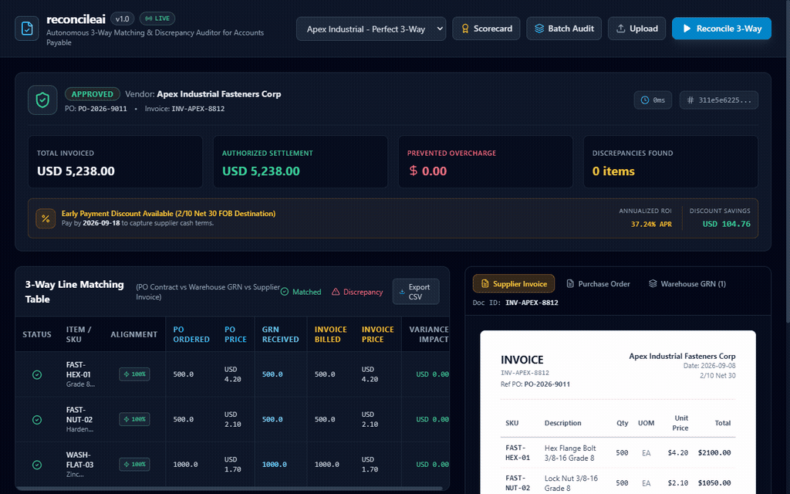
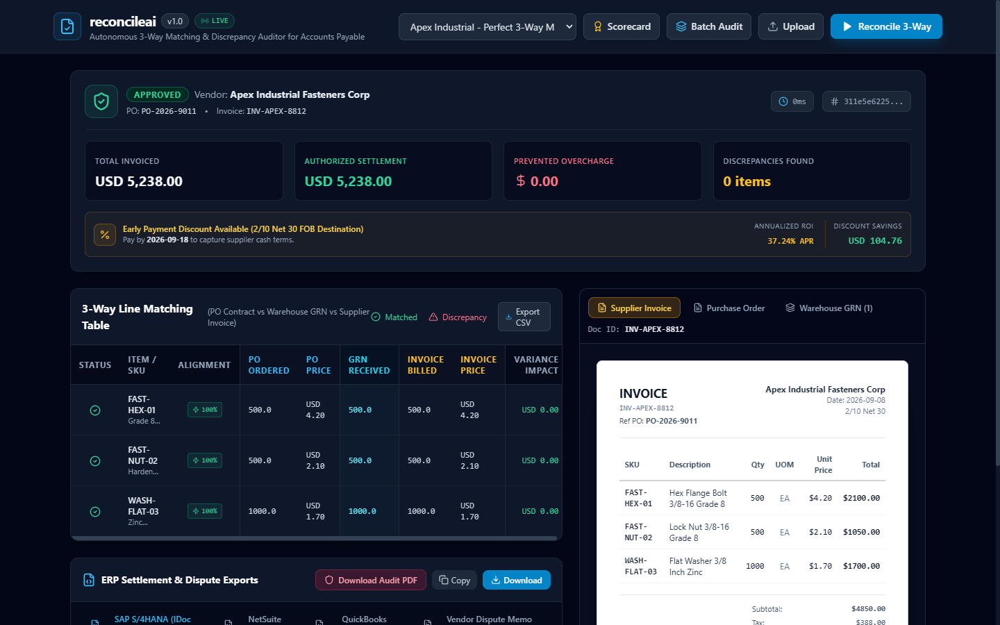
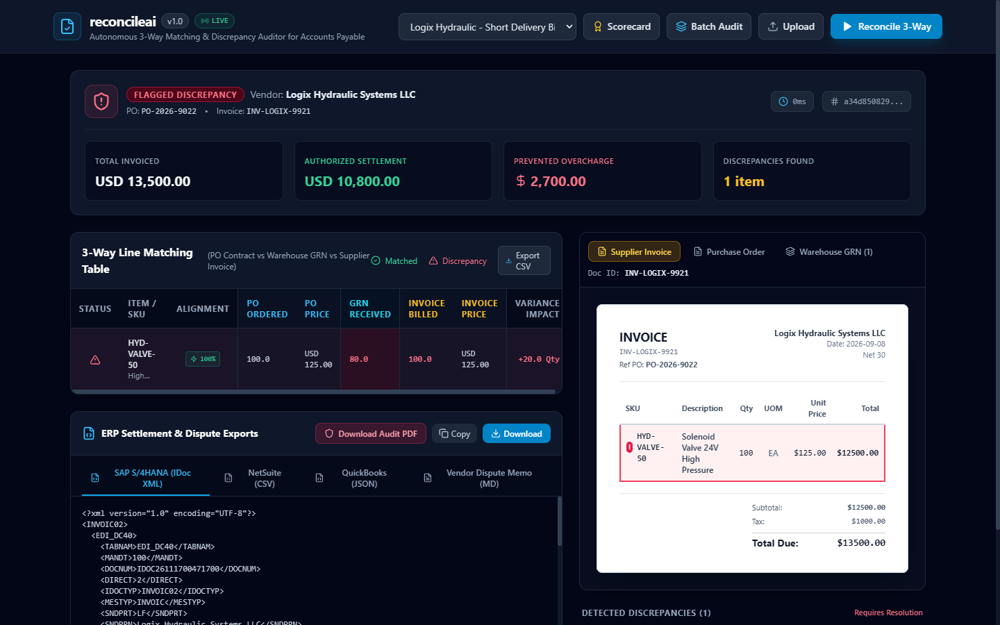
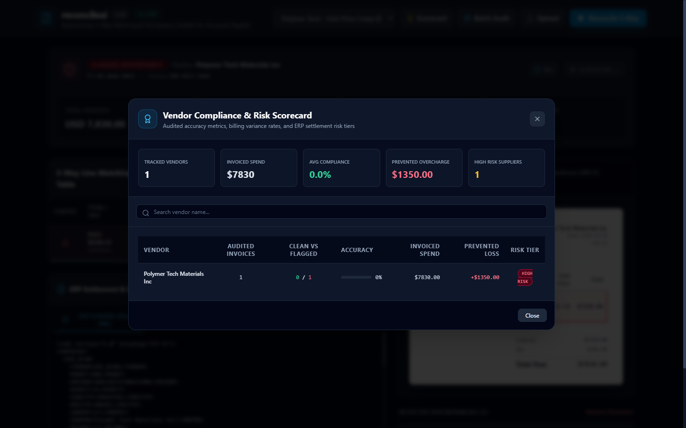
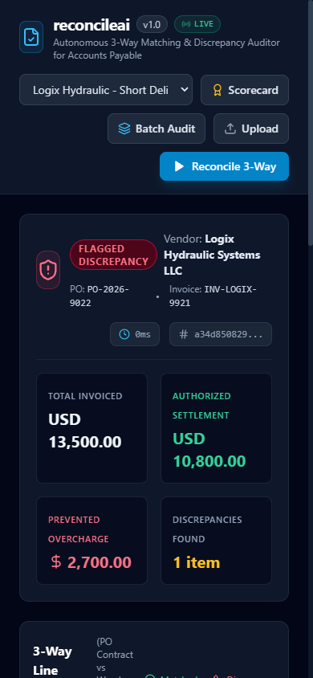

<p align="center">
  
</p>
<h1 align="center">reconcileai</h1>
<p align="center">
  <strong>Autonomous 3-Way Document Matching and Discrepancy Auditor for Enterprise Accounts Payable</strong>
</p>
<p align="center">
  <a href="https://github.com/alexandrmotologa/reconcileai/actions"></a>
  <a href="https://golang.org"></a>
  <a href="https://react.dev"></a>
  <a href="https://github.com/alexandrmotologa/reconcileai/blob/main/LICENSE"></a>
</p>

## Overview

reconcileai automates 3-way matching across purchase orders, warehouse goods receipts, and supplier invoices:

1. **Purchase order (PO)**: Internal contract detailing authorized items, quantities, agreed unit prices, and payment terms.
2. **Goods receipt note (GRN)**: Warehouse intake record specifying physical quantities received, damaged items, and receipt timestamps.
3. **Supplier invoice (INV)**: Vendor payment demand with applied unit prices, taxes, and shipping fees.

The system ingests PDF documents and structured JSON dossiers, aligns line items using token overlap and string distance metrics, applies strict mathematical audits, overlays red bounding boxes on invoice pages where discrepancies exist, and exports settlement files for SAP, NetSuite, or QuickBooks.

## Interactive cockpit and demo

reconcileai includes a single-binary web cockpit built with React 19 and Tailwind CSS. The interface displays synchronized tripartite line item diffs, live audit status, early payment discount opportunities, and visual PDF document overlays with coordinate-accurate red discrepancy bounding boxes.



### Authentic cockpit views

#### 1. Approved three-way reconciliation (Clean match)

*Synchronized comparison of PO, GRN, and Invoice with verified quantities, zero price variance, and detected 2/10 Net 30 early payment discount opportunity.*

#### 2. Discrepancy audit and visual bounding box overlay

*Quantity overbilling detected on Logix Hydraulic invoice. The audit engine flags the 20-unit variance, computes the $2,700 overcharge prevented, and projects red highlight bounding boxes onto the invoice document.*

#### 3. Supplier compliance and risk scorecard

*Aggregated historical accuracy, dispute counts, overcharges prevented, and vendor risk tiers computed across all processed dossiers.*

#### 4. Responsive mobile cockpit view
<p align="center">
  
</p>
*Fully adaptive layout across mobile, tablet, and widescreen enterprise monitors.*

## Key capabilities

- **Single-binary distribution**: The complete Go engine and compiled React 19 cockpit package into a self-contained executable with under 25 MB RAM consumption during execution.
- **Bipartite line-item matching**: Combines exact SKU lookups, substring matching, Jaro-Winkler string similarity, and token Jaccard overlap to pair vendor invoice rows with internal purchase order rows.
- **Unit of measure normalization**: Automatically converts quantities and unit prices across count units (Dozen, Case, Box, Each), mass units (Kilograms, Pounds), and volume units.
- **Multi-GRN split shipment aggregation**: Consolidates partial deliveries received across multiple dates against a single invoice.
- **Mathematical invariant auditing**:
  - Quantity check: flags billed quantities exceeding verified goods receipt intake.
  - Price variance: flags unit price increases exceeding contract tolerance thresholds.
  - Face arithmetic: checks row multiplications, subtotal summations, and tax totals.
  - Surcharge validation: detects unapproved freight or handling surcharges on FOB Destination orders.
  - Duplicate invoice detection: maintains a thread-safe ledger checking exact and fuzzy duplicate submissions.
- **Early payment discount optimization**: Parses terms such as 2/10 Net 30, calculates capture deadlines, monetary savings, and annualized return on investment (APR).
- **Vendor risk scorecards**: Aggregates historical compliance rates per supplier and assigns risk tiers based on audit accuracy.
- **Batch processing and inbox watch**: Scans directories for bulk reconciliations and monitors incoming folders for continuous processing.
- **Visual PDF evidence**: Places red rectangular bounding boxes with numbered discrepancy badges on invoice pages.
- **Dispute notice generation**: Produces itemized vendor dispute letters in Markdown and plain text citing contract clauses and document coordinates.
- **ERP settlement export**: Generates SAP S/4HANA IDoc XML (`INVOIC02`), NetSuite Bill import CSV, and QuickBooks Online JSON payment payloads.
- **Real-time cockpit**: Interactive React 19 web interface served locally on port 7272 with Server-Sent Events (SSE) streaming live audit events.

## System architecture

```
Enterprise Documents (PO, GRN, INV)
               |
               v
PDF Parsing and Spatial Coordinate Extraction
               |
               v
Semantic SKU & Line Item Alignment (Bipartite Matcher)
               |
               v
Mathematical 3-Way Auditor
               |
       +-------+-------+
       |               |
       v               v
Zero Discrepancies   Discrepancies Detected
       |               |
       v               v
ERP Settlement       Red Bounding Overlays, Dispute Memo,
(SAP, NetSuite, QB)  and React 19 Cockpit Review
```

## Quick start

### 1. Build from source

Prerequisites:
- Go 1.22 or newer
- Node.js 18 or newer

```bash
# Clone the repository
git clone https://github.com/alexandrmotologa/reconcileai.git
cd reconcileai

# Build the embedded frontend and Go binary
make build
```

### 2. Generate reference test dossiers

reconcileai includes a synthetic dossier generator that creates five realistic tripartite document sets with controlled anomalies:

```bash
./bin/reconcileai.exe generate-dossier --dir ./examples/dossiers
```

This generates:
- `dossier_01_clean_match`: full match, zero discrepancies.
- `dossier_02_qty_overbilling`: warehouse received 80 units, vendor billed for 100 units ($2,500 overcharge).
- `dossier_03_price_variance`: vendor billed $14.50/unit instead of contract price $12.00/unit ($1,250 overcharge).
- `dossier_04_unauthorized_fee`: vendor added $450 freight fee contrary to FOB Destination contract.
- `dossier_05_uom_split_delivery`: split delivery across two dates with dozen-to-each conversion.

### 3. Launch the cockpit

```bash
./bin/reconcileai.exe serve --port 7272
```

Open `http://127.0.0.1:7272` in your web browser to access the cockpit.

### 4. Run audits from the command line

```bash
# Formatted terminal table output
./bin/reconcileai.exe audit --dir ./examples/dossiers/dossier_02_qty_overbilling

# Structured JSON output
./bin/reconcileai.exe audit --dir ./examples/dossiers/dossier_02_qty_overbilling --format json

# Vendor dispute memo output
./bin/reconcileai.exe audit --dir ./examples/dossiers/dossier_02_qty_overbilling --format memo

# Batch audit across all dossier directories
./bin/reconcileai.exe batch --dir ./examples/dossiers

# Vendor compliance scorecard
./bin/reconcileai.exe scorecard --dir ./examples/dossiers
```

### 5. Export settlement payloads

```bash
# SAP S/4HANA IDoc XML
./bin/reconcileai.exe export --dir ./examples/dossiers/dossier_01_clean_match --target sap --out sap_bill.xml

# NetSuite CSV
./bin/reconcileai.exe export --dir ./examples/dossiers/dossier_01_clean_match --target netsuite --out netsuite_bill.csv

# QuickBooks Online JSON
./bin/reconcileai.exe export --dir ./examples/dossiers/dossier_01_clean_match --target quickbooks --out qb_bill.json

# Visual Evidence PDF
./bin/reconcileai.exe export --dir ./examples/dossiers/dossier_02_qty_overbilling --target pdf --out evidence.pdf
```

## Performance benchmark

Measured on standard CPU hardware (11th Gen Intel Core i5-1135G7):

- **Audit execution speed**: under 0.003 ms per tripartite document set (over 350,000 matches per second).
- **Heap memory consumption**: under 2.0 MB RAM (target: under 25 MB).
- **Binary footprint**: single 8.8 MB standalone binary including all React 19 cockpit assets.

Run benchmarks locally:
```bash
go test -bench=. -benchmem ./internal/auditor
```

## Documentation

- [docs/ARCHITECTURE.md](docs/ARCHITECTURE.md): detailed component data flows and parser mechanics.
- [docs/CLI_USAGE.md](docs/CLI_USAGE.md): command-line reference and automated scripting recipes.
- [docs/ERP_INTEGRATIONS.md](docs/ERP_INTEGRATIONS.md): SAP IDoc, NetSuite, and QuickBooks schema definitions.

## License

MIT License. See [LICENSE](LICENSE) for details.
